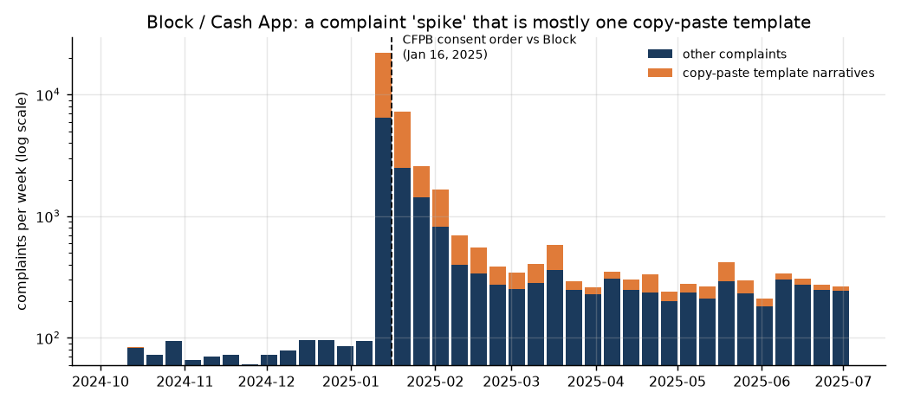
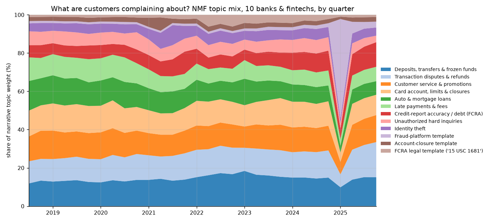
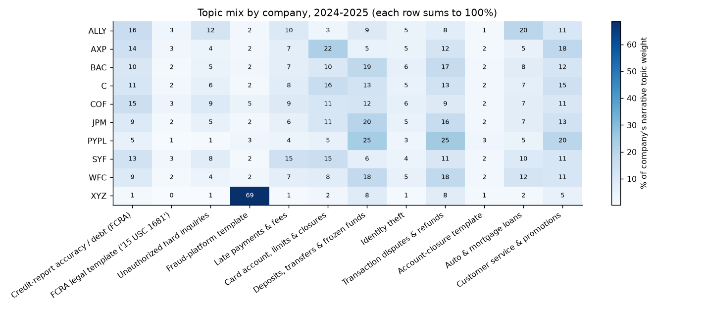
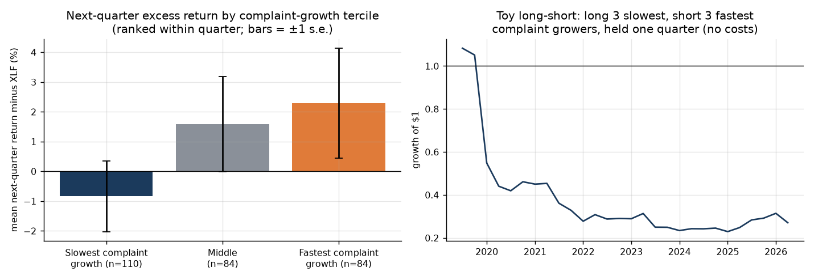
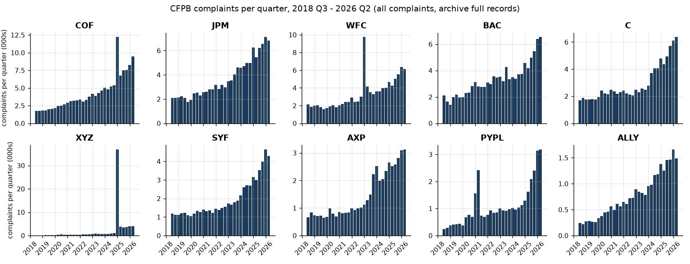
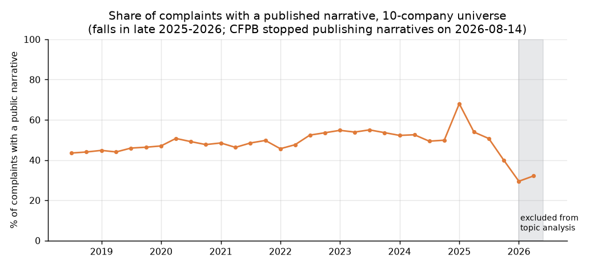
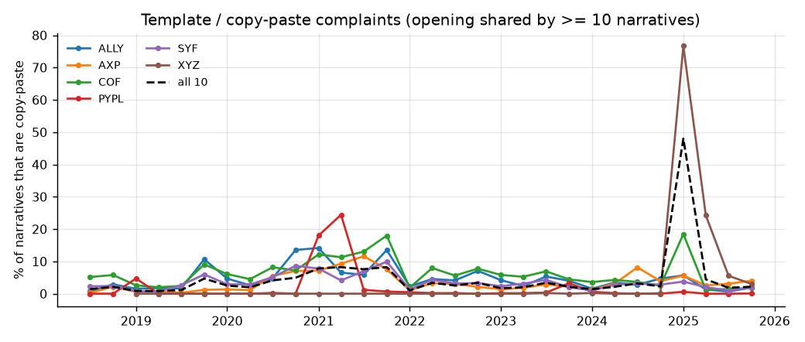

# cfpb-complaint-signals

**Can consumer-complaint text work as an alternative-data signal for US banks and fintechs?**

This project builds a text pipeline on the **CFPB Consumer Complaint Database** for 10 large US consumer-finance companies: JPMorgan Chase, Bank of America, Wells Fargo, Citi, Capital One, Synchrony, American Express, Ally, PayPal and Block (Cash App). It covers **797,477 complaints (2018 Q3 to 2026 Q2)** and **355,626 complaint narratives**. The pipeline cleans the narratives, learns complaint themes with **TF-IDF + NMF topic modeling**, builds quarterly volume and topic signals in **DuckDB SQL**, and tests whether those signals line up with **stock returns in excess of the XLF financials ETF**.

> **Data note (Aug 2026).** On 2026-08-14 the CFPB stopped publishing complaint narratives through the live database and API. The full records, including every previously published narrative, now sit in the CFPB's [FOIA reading-room archive](https://www.consumerfinance.gov/foia-requests/foia-electronic-reading-room/cfpb-consumer-complaint-database-narratives-archive/) as zipped CSV exports. The pipeline uses that archive. To confirm the archive is complete, it cross-checks counts against the live search API: **9 of 9 company-year checks match exactly**.

## Key findings (real output; see [`reports/results.md`](reports/results.md))

1. **Complaint "spikes" are often campaigns, not organic deterioration.** Block's complaints went from **1,014 in 2024 Q4 to 36,929 in 2025 Q1**, and from about 90 per week to **21,933 in the week of January 13, 2025**. That is the week of the CFPB's January 16, 2025 consent order against Block over Cash App fraud handling. **77% of Block's 2025 Q1 narratives share a copy-paste opening**, and the template's wording echoes the order ("failed to take timely … effective measures to prevent … fraud on the platform … unfair"). Capital One shows a smaller spike in the same week (5,048 complaints, 22% template, concentrated in *checking/savings: managing an account*), when the CFPB sued over 360 Savings rates (January 14, 2025). Across all narratives, **9.8% are templates**. Any volume-based signal should flag or de-duplicate them first.
2. **What customers complain about differs by business model, and the topics pick that up without supervision.** In 2024-2025, PayPal's narratives are dominated by *frozen funds / transfers* (25%) and *transaction disputes* (25%). American Express leans toward *card accounts and limits* (22%) and *service & promotions* (18%). Synchrony has the highest *late payments & fees* share (15%). Ally's largest topic is *auto & mortgage loans* (20%). Company names are removed before modeling, so these topics describe the problem, not the brand.
3. **Raw complaint growth is not a bearish stock signal in this sample.** Each quarter, the 10 names were ranked by year-over-year complaint growth. Faster growth went with slightly *better* next-quarter excess returns (within-quarter Spearman ρ = +0.10, p = 0.10). A toy strategy that is long the 3 slowest-growing names and short the 3 fastest averaged **−3.5% per quarter** (p = 0.16, 28 quarters). Complaint volume mostly scales with customer growth and product mix. The share of *untimely company responses* was more interesting: a higher share was followed by weaker next-quarter excess returns (ρ = −0.14, p = 0.015; long-short +2.9% per quarter, p = 0.06). However, only BAC, WFC and Block have meaningful non-zero values, and 9 signal/horizon pairs were tested, so this is fragile.





| | |
|---|---|
|  |  |



| | |
|---|---|
|  |  |

## Data sources (free, no API keys)

| Data | Source | Notes |
|---|---|---|
| Complaints and narratives | CFPB FOIA archive exports #2–#21 (May 2018 – Aug 2026) | About 1.3 GB zipped; filtered to the 10 companies while streaming |
| Validation counts | Live CFPB search API (`size=0` count queries) | Counts are still served; narratives are not |
| Prices | Yahoo Finance public chart endpoint | Quarterly adjusted-close returns for the 10 stocks and XLF |

## Method

```
CFPB archive zips ─► stream & filter 10 companies ─► DuckDB (838k rows)
                                                     │
narratives ─► clean (redactions, amounts, URLs, brand names) ─► TF-IDF (1-2 grams, 30k terms)
          ─► NMF, 12 topics (fit on a 111k stratified sample, applied to all 356k)
          ─► topic weights per complaint, template flag (shared 120-char opening ≥ 10x)
                                                     │
SQL (sql/quarterly_signals.sql): quarterly volume, YoY/QoQ growth (LAG), topic shares,
template shares, weekly counts, joined to returns with LEAD(1), LEAD(2) ─► analysis
```

* **Cleaning** (`text.py`). Removes CFPB redaction tokens (`XXXX`, `XX/XX/2023`), dollar placeholders (`{$1,200.00}`), URLs and non-letters. **Brand names** (Cash App, PayPal, Chase, Wells Fargo and so on) are also removed. Without that, NMF learns one topic per company, which makes "topic mix by company" circular.
* **Topics.** TF-IDF uses sublinear term frequency, `min_df=25`, `max_df=0.4`, and English plus domain stop words ("told", "called", "account" boilerplate). NMF uses `nndsvda` initialization and a fixed seed. Fitting on a sample **stratified by company-quarter** stops the largest issuers and the 2025 surge from defining the topics. The labels in `config.py` were assigned by reading each topic's top terms and its most representative narratives (`data/processed/topic_examples.csv`).
* **Templates.** A narrative counts as a template if its first 120 cleaned characters are shared by at least 10 narratives. This is a simple, explainable near-duplicate flag.
* **SQL step.** DuckDB computes the quarterly aggregates, year-over-year and quarter-over-quarter log growth with `LAG(…, 4)` and `LAG(…, 1)`, and forward returns with `LEAD`. The leads run over the *full* return history, so the last signal quarter still has a forward return. A unit test runs this SQL file on synthetic data.
* **Tests of the signal.** Spearman correlations are computed both pooled and **within quarter**, which removes market-wide moves. Each quarter, a long-low/short-high spread is formed; the tests report its t-test and hit rate. Horizons are the same quarter, the next quarter, and the quarter after next. The last one is a stricter, more tradable test, because complaints are published with a lag.

## Limitations

* **Ten names and about 30 quarters** give low statistical power, and 9 signal/horizon pairs were tested, so multiple-testing caveats apply.
* **Publication lag and look-ahead.** Complaints appear in the database after the company responds or after 15 days. A quarter's count is therefore not fully known at quarter end, which is why the q+2 horizon is included. A production version would use point-in-time snapshots.
* **Narratives are opt-in** (about 30–70% of complaints in this universe, depending on the quarter) and coverage falls in 2026. The topic analysis stops at 2025 Q4. Volume metrics use every complaint.
* **Complaints are not normalized by customer count.** Normalizing by accounts, deposits or card balances from 10-Q/Y-9C filings is the obvious next step. It would turn "more complaints" into "complaints per customer".
* **Company mapping is by CFPB entity name.** A bank holding company can appear under several entities (for example, "BANK OF AMERICA, NATIONAL ASSOCIATION"). Discover was excluded because Capital One acquired it in May 2025.
* Yahoo's chart endpoint is unofficial; production work would use licensed prices.

## How to run

```bash
python -m venv .venv && source .venv/bin/activate
pip install -r requirements.txt
make pipeline     # downloads ~1.3 GB, ingests, fits topics, builds SQL tables (~5-8 min on 8 cores)
make analysis     # reports/results.md + reports/figures/*.png
make test
# after a full run you can rebuild only the returns + SQL layer:
PYTHONPATH=src python -m cfpbsignals.pipeline --sql-only
```

## Repo layout

```
src/cfpbsignals/  config (universe, windows, topic labels), download, ingest, text (clean/TF-IDF/NMF), market, pipeline, analysis
sql/              quarterly_signals.sql (DuckDB)
data/processed/   small derived CSVs (committed); data/raw + data/interim are git-ignored
reports/          results.md + figures/
tests/            pytest: cleaning, template keys, topic separation, SQL growth/lead logic, long-short math
docs/             INTERVIEW_NOTES.md: plain-English walkthrough
```
